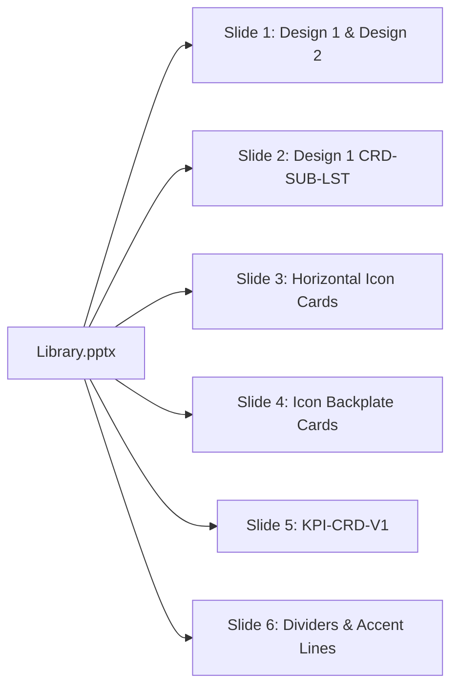
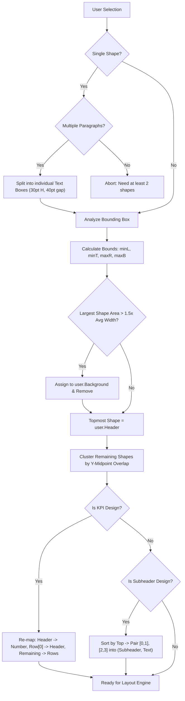
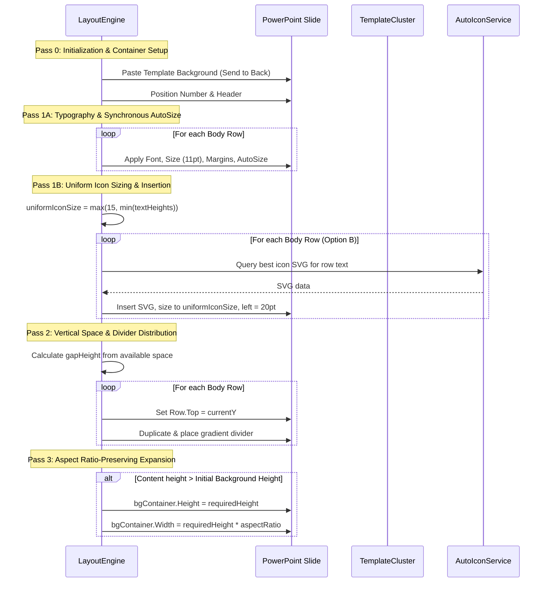

# AutoFormat: Design System, Layout Engine & AI Replication Specification

> **Version**: 1.0  
> **Status**: Authoritative Technical Specification  
> **Target Audience**: AI Agents, LLM Code Assistants, Solution Architects, PowerPoint VSTO / OpenXML / python-pptx Developers  
> **Scope**: Autonomous formatting of PowerPoint slide shapes into production-grade card archetypes with strict aspect-ratio locking, dynamic content distribution, template-based styling, and automated semantic icon injection.

---

## 1. Executive Summary & Purpose

The **AutoFormat System** transforms arbitrary, unformatted, or raw PowerPoint text and shape clusters into polished, beautifully aligned, professional card layouts. It accomplishes this through a combination of:
1. **Semantic Selection Analysis**: Deconstructing user selections or multi-line text boxes into functional roles (`Number`, `Header`, `Subheader`, `Body Text`, `Icon`, `Background`).
2. **Template Extraction from `Library.pptx`**: Reading visual prototypes (fills, borders, typography, divider lines, and geometric relationships) from master template slides.
3. **Multi-Pass Mathematical Layout Engine**: Calculating vertical space distribution, internal padding, protrusion offsets, and dynamic content-driven expansion.
4. **Strict Aspect Ratio Preservation**: Locking background containers to the template's exact width-to-height ratio so cards never deform into squares or distorted rectangles when content expands.
5. **Option B Automated Semantic Icon Service**: Extracting keywords from text, querying a remote vector icon database, and injecting uniformly scaled SVG icons without distorting typography.

This document contains all architectural patterns, mathematical formulas, color codes, file references, prototype names, and algorithms necessary for **any AI tool or automated system** to replicate the design engine with 100% precision.

---

## 2. File & Directory Reference Architecture

All files reside in or relative to the workspace root:
`c:\Users\Yash.jadhav\OneDrive - GEP\Documents\Solution Design\antigravity\AutoFormat`

```
AutoFormat/
│
├── Library.pptx                    # Primary visual template library (6 slides)
├── Before.pptx                     # Benchmark unformatted presentations
├── After.pptx                      # Benchmark target output presentations
├── Gradient Lines.pptx             # Supplementary vector divider assets
│
├── AUTOFORMAT_SPECIFICATION.md     # THIS SPECIFICATION FILE
│
└── Autoformat_v1/                  # VSTO C# Add-in Implementation
    ├── Autoformat_v1.csproj        # Visual Studio project file
    ├── FormattingAgent.cs          # Core layout engine, clustering, template extraction
    ├── AutoIconService.cs          # AI keyword matching and SVG fetching engine
    ├── DesignSelectionTaskPane.cs  # Windows Forms sidebar UI with design selector
    ├── FormattingRibbon.cs         # Office Fluent Ribbon tab and button hook
    ├── FormattingRibbon.xml        # Ribbon XML definition
    └── ThisAddIn.cs                # VSTO AddIn lifecycle and task pane management
```

### Key File Roles
- **`Library.pptx`**: Master design repository containing prototype shapes for all supported design archetypes. The layout engine opens this presentation in read-only background mode to clone background shapes, font families, font sizes, colors, and divider graphics.
- **`FormattingAgent.cs`**: The brain of the layout engine. Contains `SelectionAnalyzer`, `TemplateManager`, and `LayoutEngine`.
- **`AutoIconService.cs`**: Connects to the cloud icon repository (`https://yash-jadhav-gd.github.io/Icon_finder/assets/icons.json`) to find and download matching SVG vector graphics based on text content.
- **`Before.pptx` vs `After.pptx`**: Ground-truth validation slides. `Before.pptx` contains raw unstyled text boxes and bulleted lists. `After.pptx` contains the production output with card backplates, pill headers, gradient dividers, and icons.

---

## 3. Template Library Catalog (`Library.pptx`)

The library presentation consists of 6 dedicated slides. Shapes follow strict naming conventions so the engine can query them programmatically.



### Slide 1: Basic Card Layouts (`Design 1` & `Design 2`)
| Prototype Shape Name | Shape Type | Position `(x, y)` pt | Size `(w, h)` pt | Visual Attributes |
| :--- | :--- | :--- | :--- | :--- |
| `Design 1 Decor box` | Rounded Rectangle | `(24.5, 141.7)` | `276.4 x 279.7` | Solid fill `#FFFFFF`, subtle outline |
| `Design 1 Header Text` | Text Box / Pill | `(54.9, 126.0)` | `215.4 x 33.0` | Protruding above box; Fill `#48397E` / `#302653`, Text `#FFFFFF`, Bold $16\text{ pt}$ |
| `Design 1 Body text 1..4` | Text Box | `(34.8, 170.5..)` | `255.6 x 56.3` | Aptos $13.33\text{ pt}$ (Overridden to $11\text{ pt}$), Color `#262626` |
| `Design 2 Decor box` | Rounded Rectangle | `(320.9, 126.0)` | `276.4 x 295.4` | Solid fill `#FFFFFF` |
| `Design 2 Header Text` | Auto Shape | `(331.2, 136.2)` | `255.8 x 31.3` | Flush with box interior; Fill `#48397E`, Text `#FFFFFF`, Bold $16\text{ pt}$ |
| `Design 2 Body text 1..4` | Text Box | `(331.2, 170.5..)` | `255.8 x 56.3` | Aptos $11\text{ pt}$, Color `#262626` |
| `Grey Side Fade R Divider` | Line | `(711.7, 16.3)` | `241.0 x 0.0` | Gradient line fading out to the right, Color `#A2ABB0` |
| `Grey Centre Fade H Divider` | Line | `(703.3, 37.9)` | `243.6 x 0.0` | Gradient line fading towards both ends, Color `#A2ABB0` |

### Slide 2: Subheader List Card (`Design 1 CRD-SUB-LST`)
Designed for hierarchical lists with paired title + description items.
| Prototype Shape Name | Shape Type | Size `(w, h)` pt | Visual Attributes |
| :--- | :--- | :--- | :--- |
| `Design 1 CRD-SUB-LST Decor box` | Rounded Rectangle | `279.5 x 295.4` | Card container backplate |
| `Design 1 CRD-SUB-LSTHeader Text` | Auto Shape | `268.8 x 31.3` | Header text, Aptos $16\text{ pt}$ Bold, `#FFFFFF` |
| `Design 1 CRD-SUB-LST Sub header Text 1..4` | Text Box | `253.0 x 26.4` | Subheader, Aptos $14\text{ pt}$ SemiBold, Color `#2D3E50` |
| `Design 1 CRD-SUB-LST Body text 1..4` | Text Box | `253.0 x 26.4` | Body description, Aptos $11\text{ pt}$, Color `#262626` |

### Slide 4: Cards with Native Icon Backplates
| Prototype Shape Name | Role | Visual Attributes |
| :--- | :--- | :--- |
| `Design 1 Decor` | Card Container | `276.4 x 279.7\text{ pt}` |
| `Design 1 Header Text` | Floating Header | Aptos $16\text{ pt}$ Bold, `#FFFFFF` |
| `Tiny CircleBackplate 22..25` | Icon Backplate | Circular shapes ($34.0 \times 34.0\text{ pt}$) positioned to the left of each body row |
| `Design 1 Body Text 1..4` | Indented Body Text | Offset to $x = 88.8\text{ pt}$, width $196.3\text{ pt}$ to clear the circle backplates |

### Slide 5: KPI Metric Card (`KPI-CRD-V1`)
Designed for high-impact metrics (large numerical figure at the top, header label below, description underneath).
| Prototype Shape Name | Role | Size `(w, h)` pt | Typography & Visuals |
| :--- | :--- | :--- | :--- |
| `KPI-CRD-V1 Decor box` | Card Container | `215.4 x 92.1` | Wide landscape box. Base aspect ratio: $\mathbf{2.3387 : 1}$ ($215.4 / 92.1$). Gradient lavender/purple fill (`#C1BAE0` / `#63578E`). |
| `KPI-CRD-V1 Number` | Metric Number | `207.2 x 41.2` | Topmost position. **Aptos 28 pt Bold**, Center aligned. |
| `KPI-CRD-V1 Header Text` | Metric Label | `206.7 x 24.2` | Middle position. **Aptos 14 pt SemiBold**, Center aligned. |
| `KPI-CRD-V1 Body Text` | Description | `206.7 x 27.1` | Bottom position. **Aptos 10–11 pt Regular**, Center aligned. |

### Slide 10: Vector Dividers & Line Accents (`Library_copy.pptx` Slide 10 / Legacy Slide 6)
Divider lines are dynamically cloned and placed between rows or columns to cleanly structure content. Whenever lines are added to any slide, they **must** be sourced from Slide 10 of the library.

| Line Prototype Name | Orientation | Alignment Use Case | Visual Behavior / Gradient Formula |
| :--- | :--- | :--- | :--- |
| **`Grey Centre Fade V`** | Vertical | **Center-Aligned Content** | Vertical gradient line fading to $0\%$ alpha at top and bottom ends, solid `#A2ABB0` at center ($50\%$). Used between side-by-side columns with center-aligned text or badges. |
| **`Grey Centre Fade H`** | Horizontal | **Center-Aligned Content** | Horizontal gradient line fading to $0\%$ alpha at left and right ends, solid `#A2ABB0` at center ($50\%$). Used between vertically stacked rows or cards where content is center-aligned. |
| **`Grey Solid V`** | Vertical | **Left-Aligned / Standard** | Solid vertical line (`#A2ABB0`, $0.5\text{ pt}$ stroke). Used for vertical separation between left-aligned columns or data tables. |
| **`Grey Solid H`** | Horizontal | **Standard / Structural** | Solid horizontal line (`#A2ABB0`, $0.5\text{ pt}$ stroke). Used for table header underlines and structural grid delimiters. |
| **`Grey Side Fade R`** | Horizontal | **Left-Aligned Content** | Horizontal gradient line: $100\%$ solid `#A2ABB0` at left (where text begins), fading out to $0\%$ alpha transparency on the right. Standard divider for left-aligned text cards and list items. |

#### Deterministic Line Selection Rule:
1. **Vertical Column Arrangement**:
   - If content/text within columns is **center-aligned**: **MUST** use `Grey Centre Fade V`.
   - If content/text is **left-aligned** or standard: Use `Grey Solid V`.
2. **Horizontal Row Arrangement**:
   - If content/text within rows is **center-aligned**: **MUST** use `Grey Centre Fade H`.
   - If content/text is **left-aligned**: **MUST** use `Grey Side Fade R` (or `Grey Solid H`).
3. **Zero Shadow Requirement**: All divider lines must have strictly 0 shadow effects (`<a:effectLst>` and `<a:effectRef>` stripped).

---

## 4. Selection Analysis & Role Clustering Algorithm

Before formatting, the engine classifies unorganized user shapes into structured semantic components:



### 1. Single Text Box Paragraph Splitting
If the user selects a single text box containing multiple lines/paragraphs:
- Iterate through each paragraph $P_i$.
- If $P_i$ contains non-empty text, create a new text box:
  $$\text{Top}_i = \text{original.Top} + (i - 1) \times 40\text{ pt}, \quad \text{Height} = 30\text{ pt}, \quad \text{Width} = \text{original.Width}$$
- Copy font name, font size, bold flag, and color.
- Enable `AutoSize = ppAutoSizeShapeToFitText`.
- Delete the original compound text box and select the new individual shapes.

### 2. Semantic Role Identification
1. **Bounding Box**: Calculate $(minL, minT, maxR, maxB)$ across all shapes.
2. **Background Container**: If the shape with the largest area ($w \times h$) has width $> 1.5 \times \text{average width}$, assign it as `user.Background` and remove it from text clustering.
3. **Header**: The remaining shape with the minimum `Top` coordinate is assigned as `user.Header`.
4. **Row Clustering (Y-Midpoint Overlap)**:
   For all remaining body shapes sorted by `Top`:
   $$\text{midY} = \text{shape.Top} + \frac{\text{shape.Height}}{2}$$
   If $\text{midY}$ falls within $[\text{prev.Top}, \text{prev.Top} + \text{prev.Height}]$, group it into the current row (e.g. an icon next to text). Otherwise, start a new row.
5. **KPI Card Role Remapping**:
   When targeting `KPI-CRD-V1`:
   - `user.Number = user.Header` (Topmost shape becomes large metric number).
   - `user.Header = user.Rows[0].Text` (Second shape becomes header label).
   - `user.Rows.RemoveAt(0)` (Remaining shapes become body descriptions).
6. **Subheader Pairing**:
   When targeting `Design 1 CRD-SUB-LST`:
   - Collect all text shapes, sort strictly by `Top`.
   - Pair sequentially: item $2k \rightarrow \text{Subheader}$, item $2k + 1 \rightarrow \text{Body Text}$.

---

## 5. Multi-Pass Mathematical Layout Engine

The layout engine executes 4 synchronized passes to achieve pixel-perfect alignment.



### Mathematical Formulas & Constants

#### Geometric Offsets & Protrusion
$$\text{headerOffsetLeft} = \text{template.Header.Left} - \text{template.Background.Left}$$
$$\text{headerOffsetRight} = (\text{template.Background.Left} + \text{template.Background.Width}) - (\text{template.Header.Left} + \text{template.Header.Width})$$
$$\text{bgOffsetTop} = \text{template.Background.Top} - \text{template.Header.Top}$$

- **Protruding Header (Design 1)**:
  If $\text{bgOffsetTop} > 0$, the header floats above the card container:
  $$\text{finalBgTop} = \text{boundsTop} + \text{bgOffsetTop}$$
  $$\text{finalHeaderTop} = \text{boundsTop}$$
- **Flush Header (Design 2)**:
  If $\text{bgOffsetTop} \le 0$, the container top coincides with the bounding box top:
  $$\text{finalBgTop} = \text{boundsTop}$$
  $$\text{finalHeaderTop} = \text{boundsTop} - \text{bgOffsetTop}$$

#### Initial Background Height & Template Ratio
$$\text{templateRatio} = \frac{\text{template.Background.Height}}{\text{template.Background.Width}}$$
$$\text{finalBgHeight} = \max(50\text{ pt}, \text{finalBgWidth} \times \text{templateRatio})$$

#### Standard Internal Padding
A strict $0.3\text{ cm}$ padding margin is enforced at top and bottom:
$$\text{padding} = 0.3\text{ cm} \approx 8.5039\text{ pt}$$
$$\text{startY} = \begin{cases} 
\text{user.Header.Top} + \text{user.Header.Height} + \text{padding} & \text{if Header exists} \\
\text{finalBgTop} + \text{padding} & \text{otherwise}
\end{cases}$$
$$\text{endY} = \text{finalBgTop} + \text{finalBgHeight} - \text{padding}$$

#### Vertical Space & Gap Distribution (Pass 2)
$$\text{availableSpace} = \text{endY} - \text{startY}$$
$$\text{sumTextHeights} = \sum_{i=1}^{N} \text{rowHeight}_i$$
$$\text{sumLineHeights} = (N - 1) \times \text{sepHeight}$$
$$\text{totalEmptySpace} = \text{availableSpace} - \text{sumTextHeights} - \text{sumLineHeights}$$
$$\text{numGaps} = 2 \times (N - 1) \quad (\text{empty space distributed above and below each divider})$$
$$\text{gapHeight} = \max\left(5.0\text{ pt}, \frac{\text{totalEmptySpace}}{\text{numGaps}}\right)$$

#### Strict Aspect Ratio Locking (Pass 3)
When long text causes content to extend past the bottom edge:
$$\text{requiredHeight} = \text{currentY} + \text{padding} - \text{finalBgTop}$$
If $\text{requiredHeight} > \text{finalBgHeight}$:
$$\text{bgContainer.Height} = \text{requiredHeight}$$
$$\text{aspectRatio} = \frac{\text{template.Background.Width}}{\text{template.Background.Height}}$$
$$\mathbf{bgContainer.Width = requiredHeight \times aspectRatio}$$

> [!IMPORTANT]
> **Why Aspect Ratio Locking is Essential**: If only `Height` is increased, a wide landscape card (such as `KPI-CRD-V1`, ratio $2.34 : 1$) deforms into an unsightly square. Scaling `Width` symmetrically ensures the card retains its elegant visual proportions and breathing room on the right side.

---

## 6. Option B: Automated Semantic Icon Engine

When the "Auto-generate matching icons" checkbox is checked, the engine dynamically fetches and formats vector icons.

```mermaid
flowchart LR
    Text["Text: 'Procurement work is siloed'"] --> Clean["Clean & Filter Stop Words"]
    Clean --> Keywords["Keywords: ['procurement', 'siloed']"]
    Keywords --> Query["Query icons.json via CDN"]
    Query --> Score["Score: Label (+5), Exact Tag (+2), Partial (+1)"]
    Score --> BestIcon["Best Match: 'procurement.svg'"]
    BestIcon --> Download["Download SVG via TLS 1.2"]
    Download --> Scale["Scale to uniformIconSize = min(textHeights)"]
    Scale --> Place["Place at Left = 20pt inside Box"]
```



### 1. Remote Endpoint Specifications
- **Database URL**: `https://yash-jadhav-gd.github.io/Icon_finder/assets/icons.json`
- **Icon SVG Base URL**: `https://yash-jadhav-gd.github.io/Icon_finder/assets/icons/{file}`
- **Network Protocol Requirement**: Must force `SecurityProtocolType.Tls12` for compatibility with GitHub Pages HTTPS.

### 2. NLP Keyword Extraction & Stop Words
Extract keywords using regular expression `\b[a-zA-Z]{3,}\b`, converting tokens to lowercase, excluding the following stop words:
```csharp
"a", "an", "the", "and", "or", "but", "is", "are", "was", "were",
"in", "on", "at", "to", "for", "with", "about", "against", "between",
"into", "through", "during", "before", "after", "above", "below",
"from", "up", "down", "of", "off", "over", "under", "again", "further",
"then", "once", "here", "there", "when", "where", "why", "how", "all",
"any", "both", "each", "few", "more", "most", "other", "some", "such",
"no", "nor", "not", "only", "own", "same", "so", "than", "too", "very"
```
If no keywords remain after filtering, fallback to keyword `"circle"`.

### 3. Match Scoring Algorithm
For each candidate icon in `icons.json`:
```
score = 0
for each word in extractedKeywords:
    if icon.label.Contains(word):
        score += 5
    if icon.tags.Contains(word):
        score += 2
    else if any tag in icon.tags contains word:
        score += 1
```
The icon with the highest score is chosen. If all scores are 0, fallback to `database.First()`.

### 4. Dynamic Uniform Sizing & Alignment Rules
1. **Uniform Sizing**: To prevent jagged visual hierarchy, all icons within a card must have identical dimensions:
   $$\text{uniformIconSize} = \max\left(15\text{ pt}, \min_{r \in \text{Rows}} (\text{row}_r.\text{Text.Height})\right)$$
2. **Left Placement**:
   $$\text{iconOffsetLeft} = 20.0\text{ pt} \quad (\text{inset from card left edge})$$
3. **Text Box Horizontal Displacement**:
   To prevent text from overlapping the newly injected icon:
   $$\text{bodyOffsetLeft} = \text{iconOffsetLeft} + \text{uniformIconSize} + 15\text{ pt}$$
   $$\text{row.Text.Left} = \text{finalBgLeft} + \text{bodyOffsetLeft}$$
   $$\text{row.Text.Width} = \text{finalBgWidth} - \text{bodyOffsetLeft} - \text{bodyOffsetRight}$$
4. **Vertical Centering**:
   $$\text{row.Icon.Top} = \text{currentY} + \frac{\text{rowHeight} - \text{uniformIconSize}}{2}$$
5. **Raw Vector Preservation**: SVGs are imported in raw format without overriding fill or line colors. Native colors and multi-tone shading from the SVG asset are preserved as-is.

---

## 7. Complete Typography & Styling Standards

| Role | Font Family | Size | Weight | Color (Hex) | Alignment | Text Frame Rules |
| :--- | :--- | :--- | :--- | :--- | :--- | :--- |
| **KPI Metric Number** | `Aptos` | $28\text{ pt}$ | Bold | `#FFFFFF` or `#151514` | Center | WordWrap=True, AutoSize=ShapeToFit |
| **Card Header (Pill)** | `Aptos` | $16\text{ pt}$ | Bold | `#FFFFFF` | Center / Left | WordWrap=True, Margins=0 |
| **Flush Header** | `Aptos` | $14\text{--}16\text{ pt}$ | Bold | `#FFFFFF` | Center / Left | WordWrap=True, AutoSize=ShapeToFit |
| **Subheader** | `Aptos` | $14\text{ pt}$ | SemiBold | `#2D3E50` or `#1F2F66` | Left | WordWrap=True, AutoSize=ShapeToFit |
| **Body Text** | `Aptos` | **$11\text{ pt}$** | Regular | `#262626` | Left | WordWrap=True, AutoSize=ShapeToFit |
| **KPI Body Text** | `Aptos` | $10\text{--}11\text{ pt}$ | Regular | `#151514` | Center | WordWrap=True, AutoSize=ShapeToFit |

> [!NOTE]
> Body text size is strictly locked to **$11\text{ pt}$** across all card designs (unless explicitly designated as a KPI description at $10\text{ pt}$) to maintain enterprise readability standards.

---

## 8. Replication Guide for AI Tools & Autonomous Agents

Any AI tool or script (e.g., using `python-pptx`, OpenXML SDK, or office.js) can implement this design system by following this universal pseudo-code blueprint:

```python
def format_card_cluster(slide, selected_shapes, template_slide, design_name, add_icons=True):
    # Step 1: Selection & Role Classification
    user_cluster = analyze_selection(selected_shapes)
    
    # Step 2: Extract Prototypes from Library Slide
    decor_proto = find_shape(template_slide, design_name, "Decor")
    header_proto = find_shape(template_slide, design_name, "Header")
    body_proto = find_shape(template_slide, design_name, "Body Text")
    divider_proto = find_shape(template_slide, "Grey Side Fade R") or find_shape(template_slide, "Divider")
    number_proto = find_shape(template_slide, design_name, "Number")
    
    # Step 3: KPI Role Remapping if Number Prototype exists
    if number_proto is not None:
        user_cluster.number = user_cluster.header
        user_cluster.header = user_cluster.rows[0].text
        user_cluster.rows.pop(0)

    # Step 4: Geometry & Offsets
    header_offset_left = header_proto.left - decor_proto.left if (header_proto and decor_proto) else 15.0
    bg_offset_top = decor_proto.top - header_proto.top if (header_proto and decor_proto) else 15.0
    
    final_bg_left = user_cluster.bounds_left
    final_bg_width = user_cluster.bounds_width
    final_header_top = user_cluster.bounds_top if bg_offset_top > 0 else user_cluster.bounds_top - bg_offset_top
    final_bg_top = user_cluster.bounds_top + bg_offset_top if bg_offset_top > 0 else user_cluster.bounds_top
    
    aspect_ratio = decor_proto.width / decor_proto.height
    final_bg_height = max(50.0, final_bg_width / aspect_ratio)
    
    # Step 5: Instantiate Background Container
    bg_container = slide.clone_shape(decor_proto)
    bg_container.left, bg_container.top = final_bg_left, final_bg_top
    bg_container.width, bg_container.height = final_bg_width, final_bg_height
    bg_container.send_to_back()

    # Step 6: Position & Format Number / Header
    if user_cluster.number is not None and number_proto is not None:
        format_text(user_cluster.number, number_proto, size=28.0, bold=True)
        user_cluster.number.left = final_bg_left + header_offset_left
        user_cluster.number.top = final_header_top
        user_cluster.number.width = final_bg_width - (2 * header_offset_left)
        gap = max(5.0, header_proto.top - (number_proto.top + number_proto.height))
        final_header_top = user_cluster.number.top + user_cluster.number.height + gap

    if user_cluster.header is not None and header_proto is not None:
        format_text(user_cluster.header, header_proto, size=header_proto.font_size, bold=True)
        user_cluster.header.left = final_bg_left + header_offset_left
        user_cluster.header.top = final_header_top
        user_cluster.header.width = final_bg_width - (2 * header_offset_left)

    # Step 7: Pass 1A - Format Body Text Boxes & Measure Heights
    body_offset_left = 75.0 if add_icons else 20.0  # 20pt left + 40pt icon + 15pt gap
    body_offset_right = 20.0
    for row in user_cluster.rows:
        row.text.left = final_bg_left + body_offset_left
        row.text.width = final_bg_width - body_offset_left - body_offset_right
        format_text(row.text, body_proto, size=11.0, bold=False)
        row.text.enable_word_wrap_and_autosize()

    # Step 8: Pass 1B - Determine Uniform Icon Size & Insert SVGs
    if add_icons:
        text_heights = [r.text.height for r in user_cluster.rows if r.text is not None]
        uniform_icon_size = max(15.0, min(text_heights)) if text_heights else 30.0
        
        for row in user_cluster.rows:
            svg_content = auto_icon_service.get_best_icon_svg(row.text.text)
            row.icon = slide.insert_svg(svg_content)
            row.icon.left = final_bg_left + 20.0
            row.icon.width = uniform_icon_size
            row.icon.height = uniform_icon_size

    # Step 9: Pass 2 - Distribute Vertically with Dividers
    padding = 8.5039  # 0.3 cm
    start_y = (user_cluster.header.top + user_cluster.header.height + padding) if user_cluster.header else (final_bg_top + padding)
    end_y = final_bg_top + final_bg_height - padding
    
    num_rows = len(user_cluster.rows)
    sum_text_heights = sum(r.text.height for r in user_cluster.rows)
    sep_height = divider_proto.height if (divider_proto and num_rows > 1) else 0.0
    sum_line_heights = (num_rows - 1) * sep_height
    
    total_empty_space = (end_y - start_y) - sum_text_heights - sum_line_heights
    num_gaps = max(1, (num_rows - 1) * 2)
    gap_height = max(5.0, total_empty_space / num_gaps) if num_rows > 1 else 0.0
    
    current_y = start_y
    for i, row in enumerate(user_cluster.rows):
        row.text.top = current_y
        if row.icon is not None:
            row.icon.top = current_y + (row.text.height - uniform_icon_size) / 2
        current_y += row.text.height
        
        if i < num_rows - 1 and divider_proto is not None:
            current_y += gap_height
            sep = slide.clone_shape(divider_proto)
            sep.left = final_bg_left + 20.0
            sep.width = final_bg_width - 40.0
            sep.top = current_y
            current_y += sep_height + gap_height

    # Step 10: Pass 3 - Dynamic Aspect-Ratio-Preserving Background Expansion
    final_content_bottom = current_y + padding
    if final_content_bottom > final_bg_top + final_bg_height:
        required_height = final_content_bottom - final_bg_top
        bg_container.height = required_height
        bg_container.width = required_height * aspect_ratio  # Maintain strict ratio!
```

---

## 9. Verification & Quality Checklist

When validating any automated replication against `After.pptx`, ensure every item passes:
- [ ] **Aspect Ratio Retention**: KPI card maintains its $2.34 : 1$ landscape proportion even with long multi-line paragraphs.
- [ ] **Typography Uniformity**: All body texts are strictly formatted to **11 pt** Aptos; KPI numbers are **28 pt** Bold.
- [ ] **Protruding Header Geometry**: In Design 1, the pill header sits symmetrically above the card with no unintended vertical offset.
- [ ] **Divider Gap Symmetry**: Vertical empty space above and below each gradient divider line is identical.
- [ ] **Icon Alignment & Autoscaling**: All icons in a single card are identical in size (`uniformIconSize`), left-aligned at $20\text{ pt}$ padding, vertically centered with text, with raw SVG fills intact.
- [ ] **Z-Ordering**: The background container shape is placed at the absolute back of the z-order (`msoSendToBack`).
- [ ] **No Content Clipping**: Word wrap is enabled on all text frames, and total card height always fully encloses all text rows plus $0.3\text{ cm}$ padding.
