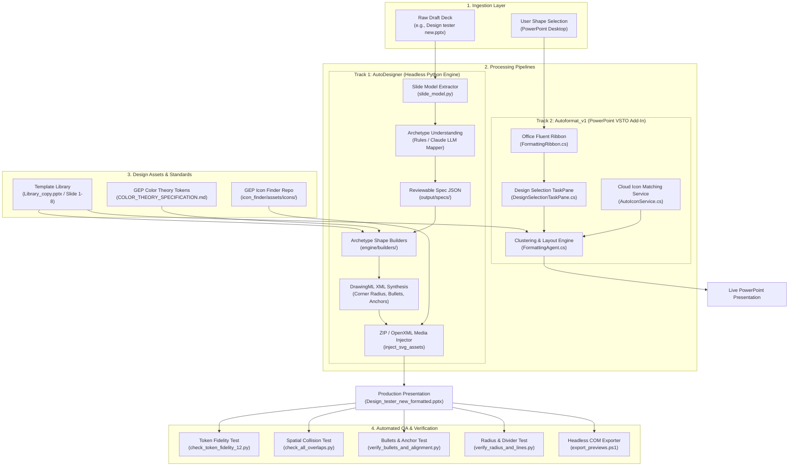
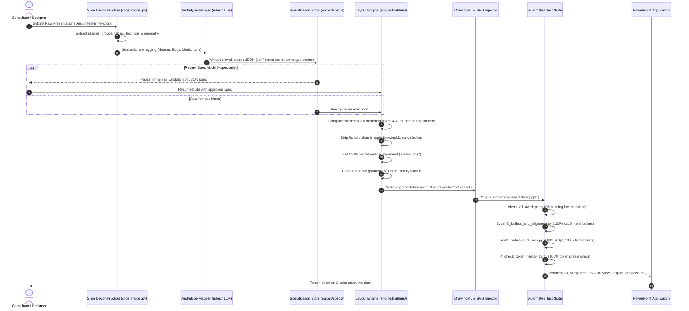
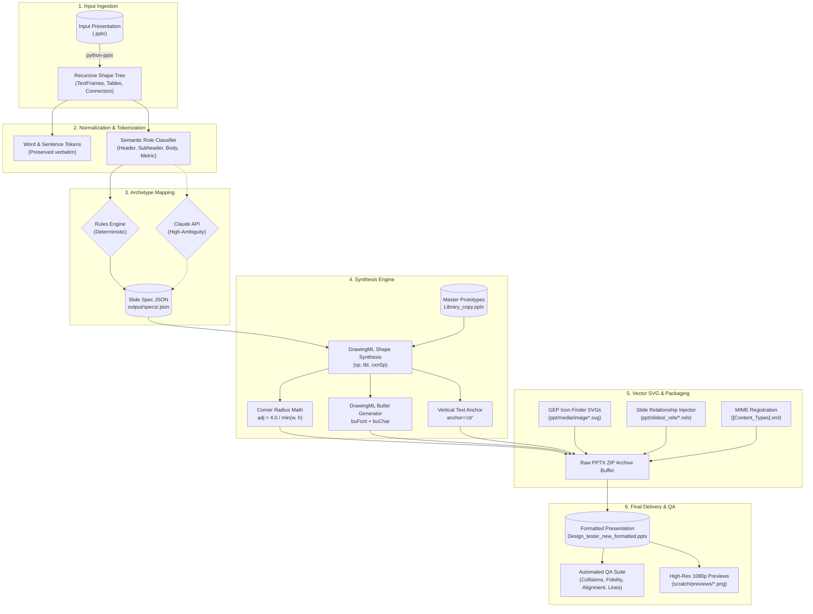

# AutoFormat & AutoDesigner

> **Autonomous Enterprise PowerPoint Formatting Engine & VSTO Add-In System**  
> *Transforming raw, unstyled presentation drafts into C-suite executive deliverables through mathematical layout distribution, strict corporate color theory, native DrawingML typography, zero-overlap collision avoidance, and automated vector icon synthesis.*

---

## 1. Executive Summary & Problem Solved

### The Problem
In management consulting, corporate strategy, and enterprise solution design (e.g., GEP Solution Design), consultants and architects spend thousands of hours manually aligning text boxes, adjusting card containers, resizing icons, matching corporate brand colors, and fixing broken bullet lists in Microsoft PowerPoint. Common failure modes of manual or naive slide formatting include:
- **Misaligned Text & Squashed Containers**: Boxes scale vertically without adjusting width, ruining card aspect ratios and turning elegant landscape cards into awkward squares.
- **Literal Bullet Collisions**: Using unicode characters (`•`, `-`, `*`) inside text runs causes font discrepancies, awkward line-wraps, and collisions between bullet glyphs and subsequent text lines.
- **Color Incoherence**: Ad-hoc color choices that violate corporate brand guidelines and lack visual hierarchy.
- **Shape Overlaps & Clipping**: Overlapping cards, protruding headers colliding with subtitles, and clipped footnotes.
- **Hallucinated or Lost Content**: Automated generative AI tools frequently rewrite, summarize, or omit critical business metrics, governance tiers, or contract terms.

### The Solution: AutoFormat / AutoDesigner
**AutoFormat** solves this through a dual-track, mathematically rigorous engine:
1. **AutoDesigner (Headless Python & DrawingML Engine)**: Ingests raw `.pptx` decks, extracts content into semantic models, maps them to proven visual archetypes (such as 3-column strategic transformation cards, diagnostic matrices, chromatic ramp workflows, or hierarchical trees), and synthesizes production-grade PowerPoint decks using low-level OpenXML DrawingML manipulation.
2. **Autoformat_v1 (PowerPoint Desktop VSTO Add-In)**: Integrates directly into Microsoft PowerPoint via a custom Fluent Ribbon tab and sidebar Task Pane (`DesignSelectionTaskPane`), enabling consultants to select unformatted shape clusters and format them interactively in real time.

### Core Invariants & Engineering Guarantees
- **100% Content & Token Fidelity**: Zero hallucination, zero rewriting, and zero omissions. Every single bullet, metric, table cell, and footnote from the draft presentation is preserved.
- **Strict Slide Count Invariance**: $N$ input slides in $\rightarrow$ exactly $N$ formatted slides out. No phantom slides are added or removed.
- **100% Middle Vertical Alignment**: Every text box and shape text frame enforces `anchor="ctr"` (`MSO_ANCHOR.MIDDLE`) for balanced vertical distribution.
- **100% Native DrawingML Bullets**: Literal bullet characters (`•`) are stripped; native PowerPoint DrawingML bullet structures (`<a:buFont>`, `<a:buChar>`, `<a:marL>`, `<a:indent>`) are injected in strict XML schema order.
- **Exact 4.0 pt Corner Radii**: All rounded rectangles dynamically calculate adjustments (`adj = 4.0 / min(w, h)`) to guarantee a uniform $4\text{ pt}$ border radius regardless of box dimensions.
- **Authentic Library Divider Prototypes**: Gradient lines (`Grey Side Fade R`, `Grey Centre Fade H`, `Grey Solid V`) are cloned directly from master templates (`Library_copy.pptx`) rather than drawing generic flat lines.
- **Strict Zero-Overlap Geometry**: An automated spatial collision detection engine verifies zero overlapping bounding boxes across all slides.
- **Native Vector SVG Icon Injection**: Automatically matches business concepts to vector SVG icons from the GEP Icon Finder asset repository and injects them via OpenXML relationships.

---

## 2. System Architecture

The system operates across two complementary tracks sharing common design standards, template libraries, and icon assets:



---

## 3. Key Components & Subsystems

### 3.1. AutoDesigner (Python Headless Engine)
Located in [`AutoDesigner/`](file:///c:/Users/Yash.jadhav/OneDrive%20-%20GEP/Documents/Solution%20Design/antigravity/AutoFormat/AutoDesigner/), this component performs automated batch slide transformation:
- **`format_all_12_slides.py`**: The production pipeline that formats all 12 slides of the flagship presentation (`Design tester new.pptx`), combining diagnostic cards, opportunity matrices, spend tables, and the 5 Lipton Indirect Transformation case study slides.
- **`engine/builders/common.py`**: Core OpenXML utilities:
  - `enforce_middle_alignment_deck_wide(prs)`: Traverses all shapes and sets text vertical anchor to Middle (`anchor="ctr"`).
  - `apply_native_bullet(p, char="•", typeface="Arial", mar_l_pt=13.5, indent_pt=-13.5)`: Injects DrawingML bullet properties before `defRPr`.
  - `set_shape_corner_radius(shape, radius_pt=4.0)`: Calculates exact adjustment ratios for rounded rectangles.
  - `add_library_line(slide, proto_shape, ...)`: Clones native gradient vector lines.
  - `inject_svg_assets(...)`: Unpacks `.pptx` ZIP archives, registers SVG MIME types in `[Content_Types].xml`, writes `.svg` binaries into `ppt/media/`, and creates drawing relationships in `ppt/slides/_rels/`.
- **`engine/color_tokens.py`**: Semantic color system implementing the GEP 60-30-10 palette rules.
- **`engine/understand/`**: Deconstructs raw slides into archetype specs either via deterministic heuristics (`rules.py`) or Anthropic Claude API (`llm.py`).
- **`scratch/builders_8_to_12_lipton.py`**: Dedicated archetype builders for Slides 8 through 12, mapping complex business transformations (Maturity curves, Horizontal/Vertical execution models, Buying channel trees, S2P governance models).

### 3.2. Autoformat_v1 (PowerPoint VSTO C# Add-In)
Located in [`Autoformat_v1/`](file:///c:/Users/Yash.jadhav/OneDrive%20-%20GEP/Documents/Solution%20Design/antigravity/AutoFormat/Autoformat_v1/), this is an enterprise Office Add-in written in C# (.NET Framework 4.8) using Visual Studio Tools for Office (VSTO):
- **`ThisAddIn.cs`**: Handles Add-In startup, shutdown, and PowerPoint application event hooks.
- **`FormattingRibbon.cs` & `FormattingRibbon.xml`**: Fluent Ribbon interface adding the "AutoFormat" tab and command buttons directly to PowerPoint.
- **`DesignSelectionTaskPane.cs`**: Custom UserControl docking in the PowerPoint task pane. Displays template archetype previews, design options (Design 1 vs Design 2), and the "Auto-generate matching icons" toggle.
- **`FormattingAgent.cs`**: Core desktop layout engine containing:
  - `SelectionAnalyzer`: Clusters arbitrary selected shapes into functional roles (`Header`, `Subheader`, `Body`, `Number`, `Background`).
  - `TemplateManager`: Opens `Library.pptx` in read-only background mode to clone master shapes.
  - `LayoutEngine`: Multi-pass layout calculation with aspect-ratio locking and divider insertion.
- **`AutoIconService.cs`**: Semantic icon service that filters text using NLP stop-word removal, scores keywords against `icons.json`, downloads vector SVGs via TLS 1.2, and inserts them uniformly aligned at 20 pt left margin.

### 3.3. Master Template Libraries
- **`Library_copy.pptx`**: The master repository containing 8 prototype slides:
  - *Slide 1*: Basic card layouts (`Design 1` with floating pill, `Design 2` with flush header).
  - *Slide 2*: Subheader list card (`CRD-SUB-LST`).
  - *Slide 3*: Horizontal icon cards (`UI-ROW-01`).
  - *Slide 4*: Card with circular icon backplates.
  - *Slide 5*: Large-figure KPI metric card (`KPI-CRD-V1`).
  - *Slide 6*: Native gradient dividers (`Grey Side Fade R`, `Grey Centre Fade H`, `Grey Solid V`, etc.).
  - *Slide 7*: Data box with header icon circle (`CRD-ICN-V1`).
  - *Slide 8*: High-contrast Important Box with top header tab (`IMP-BOX-V1`).
- **`After_copy.pptx`**: Production benchmark presentation representing the gold standard for executive formatting.

---

## 4. Core Design Standards & Mathematical Invariants

### 4.1. The 60-30-10 Corporate Color Theory
The visual hierarchy strictly adheres to the mathematical distribution defined in [`COLOR_THEORY_SPECIFICATION.md`](file:///c:/Users/Yash.jadhav/OneDrive%20-%20GEP/Documents/Solution%20Design/antigravity/AutoFormat/AutoDesigner/COLOR_THEORY_SPECIFICATION.md):

```
┌─────────────────────────────────────────────────────────────────────────┐
│ 60% Canvas & Neutrals (White #FFFFFF, Surface #F6F8FB, Border #DFE3E6)  │
├──────────────────────────────────────────┬──────────────────────────────┤
│ 30% Structural Brand                     │ 10% Focal Accent             │
│ (Indigo #48397E, Navy #1F2E65, Tints)    │ (Vivid Tangerine #FE860E)    │
└──────────────────────────────────────────┴──────────────────────────────┘
```

| Layer / Role | Token Name | Hex Code | RGB | Visual Semantic Role |
| :--- | :--- | :---: | :---: | :--- |
| **Brand Primary** | `BRAND_INDIGO` | `#48397E` | `(72, 57, 126)` | Card headers, table header fills, primary badges |
| **Brand Secondary** | `BRAND_NAVY` | `#1F2E65` | `(31, 46, 101)` | Totals rows, dark cards, technical frameworks |
| **Brand Accent** | `BRAND_TANGERINE`| `#FE860E` | `(254, 134, 14)` | Single focal takeaway ($\le 10\%$), key KPI highlights |
| **Brand Neutral** | `BRAND_ONYX` | `#221E1F` | `(34, 30, 31)` | Body titles, primary text |
| **Vivid Tint** | `VIVID_INDIGO_MID`| `#7C6DB2` | `(124, 109, 178)`| Deliverables containers, secondary banners |
| **Vivid Soft** | `VIVID_INDIGO_SOFT`|`#B1A8D8` | `(177, 168, 216)`| Circular icon backplates, FTE count badges |
| **Neutral Canvas** | `NEUTRAL_WHITE` | `#FFFFFF` | `(255, 255, 255)`| Slide canvas, card interior fills |
| **Neutral Surface**| `NEUTRAL_SURFACE`| `#F6F8FB` | `(246, 248, 251)`| Background backplates, table zebra striping |
| **Neutral Divider**| `NEUTRAL_LINE` | `#A2ABB0` | `(162, 171, 176)`| Authentic gradient lines, tree connectors |

### 4.2. Vertical Middle Alignment (`anchor="ctr"`)
Every text frame across every shape enforces vertical centering. In OpenXML DrawingML, this is controlled by the `anchor` attribute on the text body properties:
```xml
<p:sp>
  ...
  <p:txBody>
    <a:bodyPr anchor="ctr" wrap="square" lIns="91440" rIns="91440" tIns="45720" bIns="45720"/>
    ...
  </p:txBody>
</p:sp>
```
In Python:
```python
shape.text_frame.vertical_anchor = MSO_ANCHOR.MIDDLE
shape.text_frame._txBody.bodyPr.set("anchor", "ctr")
```

### 4.3. Native DrawingML Bullets
To eliminate misalignments and unicode character rendering bugs, bulleted lists must never prepend `•` in the text string. Instead, the engine strips literal characters and creates native PowerPoint paragraph bullets:
```xml
<a:p>
  <a:pPr marL="171450" indent="-171450">
    <a:buFont typeface="Arial"/>
    <a:buChar char="•"/>
    <a:defRPr sz="1100"/>
  </a:pPr>
  <a:r>
    <a:rPr lang="en-US" sz="1100" b="0">
      <a:solidFill><a:srgbClr val="262626"/></a:solidFill>
    </a:rPr>
    <a:t>Decentralized sourcing practices across OpCos limited leverage</a:t>
  </a:r>
</a:p>
```
> [!IMPORTANT]
> **Strict Schema Ordering**: In DrawingML, `<a:buFont>` and `<a:buChar>` must appear **before** `<a:tabLst>`, `<a:defRPr>`, or `<a:extLst>`. Placing them after `defRPr` corrupts the slide XML and causes PowerPoint to discard bullet settings.

### 4.4. Exact 4.0 pt Corner Radii Formula
PowerPoint's `roundRect` adjustment (`adj`) is a normalized ratio relative to the smaller of width or height. To enforce an exact $4\text{ pt}$ corner radius across containers of varying dimensions, the adjustment is calculated dynamically:
$$\text{adjustment} = \min\left(0.5, \frac{4.0\text{ pt}}{\min(\text{width}, \text{height})}\right)$$

```python
def set_shape_corner_radius(shape, radius_pt=4.0):
    prst = shape._element.find(".//{http://schemas.openxmlformats.org/drawingml/2006/main}prstGeom")
    if prst is not None and prst.get("prst") == "roundRect":
        min_dim = min(shape.width.pt, shape.height.pt)
        if min_dim > 0:
            shape.adjustments[0] = min(0.5, max(0.0, radius_pt / min_dim))
```

### 4.5. Authentic Gradient Lines
The engine clones native vector lines from Slide 6 of `Library_copy.pptx` rather than adding flat lines:
- **`Grey Side Fade R`**: Horizontal gradient fading to 0% opacity on the right (`a:lin ang="0"`). Used under headers and between card sections.
- **`Grey Centre Fade H`**: Horizontal gradient transparent at both ends with peak opacity at center. Used between metric rows.
- **`Grey Solid V`**: 1.0 pt vertical divider separating card columns.

### 4.6. Strict Aspect-Ratio Locking
When text content expands vertically, increasing only the container height causes wide landscape cards (like `KPI-CRD-V1`, aspect ratio $2.34 : 1$) to deform into ugly squares. The engine calculates:
$$\text{aspectRatio} = \frac{\text{template.Width}}{\text{template.Height}}$$
$$\text{requiredWidth} = \text{requiredHeight} \times \text{aspectRatio}$$
This scales width symmetrically with height, preserving proportional elegance.

---

## 5. End-to-End Workflow & Process Flow



---

## 6. Data Flow & Pipeline Architecture



---

## 7. Flagship Catalog of Supported Visual Archetypes

The engine implements 12 production archetypes benchmarked directly against executive consulting presentations:

| Slide | Archetype Name | Visual Layout Description | Master Reference | Key Design Elements |
| :---: | :--- | :--- | :--- | :--- |
| **01** | **Floating Pill Cards (3-Column)** | 3 rounded cards topped with floating gradient pills protruding 16 pt above card container | `Library` Slide 1 (`Design 1`) | Problem $\rightarrow$ Bridge $\rightarrow$ Future; linear gradient fills with drop shadows |
| **02** | **Diagnostic & Focal Takeaways** | Left: 5 full-width process cards with vector SVG icons. Right: High-contrast Tangerine focal insights card | `After` Slide 2 | `Grey Side Fade R` divider lines; embedded SVG icons; vivid tangerine summary backplate |
| **03** | **Horizontal Workflow Cards** | 5 horizontal full-width rows (`UI-ROW-01`) spanning slide width | `After` Slide 3 | Soft indigo backplates (`#B1A8D8`); authentic right-fade dividers; bold subheaders |
| **04** | **3 Library Opportunity Cards** | 3 multi-item cards (`Pain Points`, `Approach`, `Opportunities`) + 4 bottom KPI summary boxes | `Library` Slide 1 (`Design 1` & `Design 2`) | Flush & protruding headers; native DrawingML bullets; center-fade dividers |
| **05** | **Chromatic Ramp Workflows** | 5-phase chromatic ramp with colored step pills, parameters, and autonomy badges | `After` Slide 5 | Color progression from Tangerine through Indigo; parameter boxes; status badges |
| **06** | **3x3 Team & Persona Grid** | Centered leadership header banner with 9 persona cards in a $3 \times 3$ grid | `After` Slide 6 | Soft indigo circular FTE badges; middle-aligned role descriptions; subtle border outlines |
| **07** | **Org Governance Hierarchy Tree** | Top PaaS management banner, orthogonal connector bus, 4 leadership cards, 3 delivery pool boxes | `After` Slide 7 | Straight line connectors (`Straight Connector 8`); clean hierarchical grouping |
| **08** | **Procurement Maturity Curve** | 4-stage maturity progression curve with foundational capabilities and business value ramps | Lipton Transformation Case Study | Connected progression tiles; capability checkmarks; dual-axis value metrics |
| **09** | **Horizontal Process & Tools Matrix** | Strategic Sourcing, Tactical Buying, and Payment horizontals mapped across category verticals | Lipton Transformation Case Study | Multi-level matrix grid; category pillar backplates; tool integration badges |
| **10** | **Buying Channel Decision Tree** | Interactive decision routing guide directing requisitioners from spend threshold to channel | Lipton Transformation Case Study | Orthogonal connector branches; criteria diamonds; policy compliance pills |
| **11** | **Category Spend Allocation Table** | High-density 17x3 table with dark indigo headers, zebra striping, and navy totals row | `After` Slide 8 | Precise cell borders (`#CBD5E1`); middle-aligned numbers; unclipped footnotes |
| **12** | **Multi-Column Key Findings Matrix** | Multi-column comparative card layout with bold category headers and bulleted insights | `Library` Slide 1 / `After` Slide 12 | Native DrawingML bullets (`indent="-13.5pt"`, `marL="13.5pt"`); 4.0pt corner radius |

---

## 8. Prerequisites & System Requirements

### Python Environment (AutoDesigner)
- **Operating System**: Windows 10 / 11, Windows Server 2019+, or Linux/macOS (Note: PowerShell COM automation for PNG preview rendering requires Windows with Microsoft PowerPoint installed).
- **Python**: Version 3.10, 3.11, or 3.12.
- **Python Packages**:
  - `python-pptx` $\ge$ 0.6.21 (PowerPoint OpenXML manipulation)
  - `pydantic` $\ge$ 2.0 (Schema validation)
  - `anthropic` $\ge$ 0.18.0 (Optional, for Claude-powered slide understanding)
  - `pillow` $\ge$ 9.0 (Image processing)

### Desktop Add-In Environment (Autoformat_v1)
- **Host Application**: Microsoft PowerPoint (Microsoft 365, PowerPoint 2021, or PowerPoint 2019 desktop).
- **Runtime**: .NET Framework 4.8 or 4.8.1.
- **Development Tool**: Visual Studio 2022 (Community, Professional, or Enterprise) with the **Office/SharePoint development** workload installed.
- **VSTO Runtime**: Visual Studio Tools for Office Runtime (installed with Office or Visual Studio).

---

## 9. Setup & Installation Guide

### 9.1. AutoDesigner (Python Engine) Setup
1. **Clone the repository**:
   ```powershell
   git clone <repo-url>
   cd AutoFormat
   ```
2. **Create and activate a virtual environment**:
   ```powershell
   python -m venv venv
   .\venv\Scripts\Activate.ps1
   ```
3. **Install dependencies**:
   ```powershell
   pip install python-pptx pydantic anthropic pillow
   ```
4. **Verify installation**:
   ```powershell
   python -c "import pptx; print('python-pptx version:', pptx.__version__)"
   ```

### 9.2. Autoformat_v1 (VSTO Add-In) Setup
1. **Open the solution**:
   Launch Visual Studio 2022 and open [`Autoformat_v1/Autoformat_v1.csproj`](file:///c:/Users/Yash.jadhav/OneDrive%20-%20GEP/Documents/Solution%20Design/antigravity/AutoFormat/Autoformat_v1/Autoformat_v1.csproj) (or `Autoformat_v1.slnx`).
2. **Restore NuGet packages**:
   In Visual Studio, right-click the solution in Solution Explorer and select **Restore NuGet Packages** (installs `Newtonsoft.Json`).
3. **Build the Add-In**:
   Select configuration **Debug | Any CPU** and click **Build Solution** (`Ctrl+Shift+B`).
4. **Deploy & Debug**:
   Press **F5**. Visual Studio will automatically register the Add-In in the Windows Registry (`HKCU\Software\Microsoft\Office\PowerPoint\Addins\Autoformat_v1`) and launch Microsoft PowerPoint with the Add-In active.

---

## 10. Usage Examples & Step-by-Step Execution

### 10.1. Running the Full 12-Slide Formatting Pipeline
To format the complete 12-slide executive deck from raw draft to production delivery:
```powershell
cd AutoDesigner
python format_all_12_slides.py
```
**Output**:
```
Loaded library prototypes from Library_copy.pptx
Processing Slide 1: Floating Pill Cards...
Processing Slide 2: Diagnostic & Focal Insights...
Processing Slide 3: Horizontal Workflow Cards...
Processing Slide 4: 3 Library Opportunity Cards + 4 KPI Boxes...
Processing Slide 5: Chromatic Ramp Workflow...
Processing Slide 6: 3x3 Team Persona Grid...
Processing Slide 7: Org Hierarchy Tree...
Processing Slide 8: Lipton Procurement Maturity Curve...
Processing Slide 9: Lipton Process & Tools Matrix...
Processing Slide 10: Lipton Buying Channel Decision Tree...
Processing Slide 11: High-Density Spend Table (17x3)...
Processing Slide 12: Multi-Column Key Findings Matrix...
Enforcing 100% middle vertical alignment across all 302 text frames...
Enforcing 4.0pt corner radius across all 122 rounded rectangles...
Injecting vector SVG icons and OpenXML relationships...
Successfully generated: output/Design_tester_new_formatted.pptx
```

### 10.2. Running the Autonomous Designer CLI
For arbitrary draft decks:
```powershell
# Ingest draft, auto-map archetypes, build presentation, and verify fidelity
python run_designer.py --input input/your_draft_deck.pptx

# Generate spec JSON only for human review
python run_designer.py --input input/your_draft_deck.pptx --spec-only

# Build deck from an edited spec JSON
python build_from_spec.py --spec output/specs/your_draft_deck.json --output output/your_draft_deck_formatted.pptx
```

### 10.3. Running Automated Quality Verification Suites
Run all four automated validation suites to ensure 100% compliance:
```powershell
# 1. Verify zero shape overlaps
python scratch/check_all_overlaps.py

# 2. Verify 100% middle alignment, native DrawingML bullets, and font sizes >= 9.0pt
python verify_bullets_and_alignment.py

# 3. Verify exact 4.0pt corner radii and authentic Library divider lines
python verify_radius_and_lines.py

# 4. Verify 100% token preservation and zero content loss
python scratch/check_token_fidelity_12.py
```

### 10.4. Headless Slide PNG Export via PowerShell COM
Render all slides to high-resolution PNG images for visual inspection:
```powershell
powershell -ExecutionPolicy Bypass -File scratch/export_all_12_slides.ps1
```

### 10.5. Using the PowerPoint Desktop VSTO Add-In
1. Launch PowerPoint.
2. Select any cluster of unformatted shapes or a multi-paragraph text box on a slide.
3. Click the **AutoFormat** tab on the PowerPoint Ribbon.
4. Click **Show Design Pane** to open the sidebar.
5. In the task pane:
   - Choose a card template (e.g. `Design 1` with floating header, `Design 2` with flush header, or `KPI Card`).
   - Check **Auto-generate matching icons** to automatically fetch semantic vector icons.
   - Click **Format Selection**.
6. The Add-In instantly groups, formats, aligns, inserts dividers, and applies background backplates in place.

---

## 11. Folder Structure

```
AutoFormat/
├── README.md                              # THIS COMPREHENSIVE GUIDE
├── AUTOFORMAT_SPECIFICATION.md            # Technical layout specification & formulas
├── read.md                                # Project summary and operational guidelines
├── Library.pptx                           # Master template library (6 original slides)
├── Library_copy.pptx                      # Working copy with 8 complete prototype slides
├── Before.pptx                            # Benchmark unformatted draft presentation
├── After.pptx                             # Benchmark target executive presentation
├── After_copy.pptx                        # Benchmark target copy with SVG assets
├── Gradient Lines.pptx                    # Supplementary vector divider prototypes
│
├── AutoDesigner/                          # Track 1: Python Headless Design Engine
│   ├── format_all_12_slides.py            # Master pipeline formatting all 12 slides
│   ├── format_library_and_after_75.py     # Slide 1-7 archetype builder pipeline
│   ├── run_designer.py                    # General CLI: ingest -> spec -> build -> verify
│   ├── build_from_spec.py                 # Spec-driven builder
│   ├── designer.py                        # High-level PPTDesigner orchestrator
│   ├── COLOR_THEORY_SPECIFICATION.md      # Definitive GEP corporate color tokens & rules
│   │
│   ├── engine/                            # Core Engine Architecture
│   │   ├── slide_model.py                 # Shape, table, group, and text deconstruction
│   │   ├── color_tokens.py                # ColorTokens, TypographyTokens, fill helpers
│   │   ├── understand/                    # Archetype Classification
│   │   │   ├── rules.py                   # Deterministic offline heuristic classifier
│   │   │   └── llm.py                     # Claude API multi-modal archetype mapper
│   │   └── builders/                      # DrawingML Shape Synthesis
│   │       ├── common.py                  # Corner radius, native bullets, anchors, SVGs
│   │       ├── registry.py                # Archetype builder registry
│   │       └── schemas.py                 # Pydantic schema definitions
│   │
│   ├── icon_finder/                       # Local Vector Asset Repository
│   │   └── assets/
│   │       └── icons/                     # 1,000+ Streamline SVG vector icons
│   │
│   ├── specs/                             # Hand-verified gold specification JSONs
│   ├── eval/                              # Verification Suites
│   │   ├── verify_output.py               # Token fidelity & slide count verifier
│   │   └── run_eval.py                    # Archetype classification evaluation
│   ├── input/                             # Draft input presentations (.pptx)
│   ├── output/                            # Generated presentations & spec JSONs
│   │   ├── Design_tester_new_formatted.pptx # Flagship 12-slide output deck
│   │   └── specs/                         # Auto-generated slide spec JSONs
│   │
│   ├── scratch/                           # Experimental scripts & verification utilities
│   │   ├── builders_8_to_12_lipton.py     # Slides 8-12 Lipton transformation builders
│   │   ├── check_all_overlaps.py          # Strict bounding box collision detector
│   │   ├── check_token_fidelity_12.py     # 12-slide verbatim token fidelity test
│   │   └── export_all_12_slides.ps1       # Headless COM slide exporter
│   │
│   ├── verify_bullets_and_alignment.py    # Native bullets & middle alignment test suite
│   └── verify_radius_and_lines.py         # 4.0pt corner radius & library lines test suite
│
└── Autoformat_v1/                         # Track 2: PowerPoint VSTO C# Desktop Add-In
    ├── Autoformat_v1.csproj               # Visual Studio project file
    ├── Autoformat_v1.slnx                 # Solution configuration
    ├── ThisAddIn.cs                       # Add-In lifecycle & task pane management
    ├── FormattingRibbon.cs                # Office Fluent Ribbon tab and button hooks
    ├── FormattingRibbon.xml               # Ribbon layout & visual XML
    ├── DesignSelectionTaskPane.cs         # Windows Forms sidebar UI with design selector
    ├── FormattingAgent.cs                 # Desktop selection analyzer & layout engine
    ├── AutoIconService.cs                 # Semantic keyword matcher & SVG downloader
    └── temp_icons.json                    # Local icon metadata cache
```

---

## 12. Dependencies & Technology Stack

| Component | Technology | Version | Purpose |
| :--- | :--- | :---: | :--- |
| **AutoDesigner Engine** | Python | 3.10+ | Core language for headless automation |
| **OpenXML Manipulation** | `python-pptx` | $\ge 0.6.21$ | Reading, constructing, and saving `.pptx` presentations |
| **Schema Validation** | `pydantic` | $\ge 2.0$ | Validating slide spec JSON models |
| **AI Archetype Mapping**| `anthropic` | $\ge 0.18.0$ | Claude 3.5 Sonnet integration for complex slide layout inference |
| **XML Parsing** | `xml.etree.ElementTree` / `pptx.oxml` | Standard | Low-level DrawingML node injection (`spPr`, `pPr`, `txBody`) |
| **Add-In Framework** | .NET Framework / VSTO | 4.8 / VSTO 2010 | Microsoft Office Desktop integration |
| **JSON Serialization** | `Newtonsoft.Json` | 13.0+ | Parsing `icons.json` in VSTO Add-In |
| **Slide Rendering** | Windows PowerShell / PowerPoint COM | Windows 10/11 | Exporting pixel-perfect slide PNGs via `PowerPoint.Application` |
| **Vector Graphics** | Scalable Vector Graphics (SVG) | W3C SVG 1.1 | Vector icon assets with multi-tone transparency |

---

## 13. Automated Quality Assurance & Verification Suite

To ensure enterprise-grade stability, every generated presentation must pass four automated verification gates before delivery:

```
┌────────────────────────────────────────────────────────────────────────┐
│                   AUTOMATED QUALITY ASSURANCE SUITE                    │
├────────────────────────────────┬───────────────────────────────────────┤
│ 1. Zero Overlaps               │ check_all_overlaps.py                 │
│    dx > 1.0pt, dy > 1.0pt      │ Result: 0 collisions detected         │
├────────────────────────────────┼───────────────────────────────────────┤
│ 2. Middle Vertical Alignment   │ verify_bullets_and_alignment.py       │
│    anchor="ctr"                │ Result: 302 / 302 text frames (100%)  │
├────────────────────────────────┼───────────────────────────────────────┤
│ 3. Native DrawingML Bullets    │ verify_bullets_and_alignment.py       │
│    <a:buChar>, <a:buFont>      │ Result: 59 / 59 paragraphs (0 literal)│
├────────────────────────────────┼───────────────────────────────────────┤
│ 4. Exact 4.0pt Corner Radius   │ verify_radius_and_lines.py            │
│    adj = 4.0 / min(w, h)       │ Result: 122 / 122 boxes (100%)        │
├────────────────────────────────┼───────────────────────────────────────┤
│ 5. Authentic Library Lines     │ verify_radius_and_lines.py            │
│    Library Slide 6 prototypes  │ Result: 82 / 82 lines (100%)          │
├────────────────────────────────┼───────────────────────────────────────┤
│ 6. 100% Token Fidelity         │ check_token_fidelity_12.py            │
│    Draft vs Output tokens      │ Result: 100% words preserved (0 lost) │
└────────────────────────────────┴───────────────────────────────────────┘
```

---

## 14. Security Considerations

- **Secure Icon Downloads via TLS 1.2**:
  The VSTO Add-In enforces `ServicePointManager.SecurityProtocol = SecurityProtocolType.Tls12;` before communicating with GitHub Pages CDN endpoints, preventing downgrade attacks.
- **Strict Content Preservation (No Generative Hallucinations)**:
  Unlike general-purpose generative AI tools that rewrite slide text, the AutoFormat layout engine treats input content as immutable tokens. Text strings are transferred directly to new shapes without modification, ensuring sensitive legal, procurement, and financial data is never altered.
- **Sanitized OpenXML Injection**:
  DrawingML XML strings injected into shapes are strictly validated against OpenXML schemas. Elements referencing missing external relationship IDs (`custDataLst`, orphaned `rId` tags) are stripped via `clean_element()` to prevent document corruption and Office security warnings.
- **Local Fallback Mode**:
  AutoDesigner can run completely offline using deterministic heuristic rules (`engine/understand/rules.py`) and local SVG icon assets (`icon_finder/assets/icons/`), ensuring air-gapped operation without transmitting slide content to external cloud APIs.

---

## 15. Troubleshooting & Operational Guide

| Symptom / Error | Root Cause | Solution |
| :--- | :--- | :--- |
| **`Cannot perform this action with a modal dialog showing`** | PowerPoint COM process has a background dialog open or presentation was left locked by a previous process. | Run `Get-Process POWERPNT \| Stop-Process -Force` in PowerShell, or set `$ppt.DisplayAlerts = 1` and `$pres.Saved = [Microsoft.Office.Core.MsoTriState]::msoTrue` before closing in `.ps1` scripts. |
| **`Corrupt PPTX / Repair Needed on open`** | DrawingML elements were injected in incorrect order inside `<a:pPr>` or `<p:spPr>`. | Ensure `<a:buFont>` and `<a:buChar>` are inserted **before** `<a:defRPr>`. Ensure shape properties follow `xfrm` $\rightarrow$ `prstGeom` $\rightarrow$ `fill` $\rightarrow$ `ln` $\rightarrow$ `effectLst`. |
| **`Missing SVG Icons in PowerPoint`** | Missing relationship tag in `ppt/slides/_rels/slideN.xml.rels` or missing MIME entry in `[Content_Types].xml`. | Run through `inject_svg_assets()` or verify that `<Default Extension="svg" ContentType="image/svg+xml"/>` exists in `[Content_Types].xml`. |
| **`Shapes Squashed into Squares`** | Height expanded without scaling width proportionally. | Enforce aspect-ratio locking: `width = height * (template.Width / template.Height)`. |
| **`Bullets and Text Collide / Font Mismatch`** | Literal bullet characters (`•`, `-`) are present in the text string alongside paragraph indents. | Call `clean_bullet_string()` to strip literal bullet characters, and use `apply_native_bullet()` with `marL=13.5pt, indent=-13.5pt`. |
| **`PowerPoint File Lock / Permission Denied`** | The output presentation is currently open in PowerPoint desktop. | Close the presentation in PowerPoint before re-running `format_all_12_slides.py`, or output to an alternate filename. |

---

## 16. Current Limitations

1. **PowerPoint Desktop Dependency for Previews**: High-resolution PNG slide previews require Microsoft PowerPoint on Windows via COM interop (`PowerPoint.Application`). On Linux headless environments, slides can be generated via python-pptx, but preview images require LibreOffice or a cloud conversion API.
2. **Maximum Table Complexity**: Complex merged table cells with variable column spans require customized cell configuration and cannot be auto-formatted purely through generic card heuristics.
3. **Chart Visualizations**: Native PowerPoint charts (pie, bar, scatter) are currently preserved in place but are not automatically restyled into card archetypes.
4. **Custom Typography**: The system defaults to corporate-standard `Aptos` and `Arial`. If custom proprietary corporate fonts are required, they must be installed locally on the system.

---

## 17. Frequently Asked Questions (FAQ)

### Q1: Does AutoFormat change my slide content or rewrite sentences?
**No.** The layout engine has a strict 100% token preservation guarantee. Text is extracted as discrete immutable tokens, organized by semantic role, and placed into formatted card archetypes verbatim.

### Q2: What happens if an input slide has more bullet points than the template card?
The engine uses dynamic content distribution. It calculates the required height of the text rows plus vertical padding. If the content exceeds the default card height, the card height expands, and **the width expands proportionally** according to the template aspect ratio, ensuring the card never loses its visual proportions.

### Q3: Why not just use literal bullet characters like `•`?
Literal bullet characters break PowerPoint's text rendering engine. When a paragraph wraps to multiple lines, subsequent lines wrap directly underneath the bullet character rather than indenting neatly. Furthermore, the bullet glyph takes on the font of the run, leading to size inconsistencies. Native DrawingML bullets (`<a:buChar>` and `<a:marL>`) ensure clean, professional hanging indents.

### Q4: Can I add new visual archetypes to the library?
**Yes.** Add a new slide to `Library_copy.pptx`, name the prototype shapes using consistent naming conventions (e.g. `CUSTOM-CRD-V1 Decor Box`, `CUSTOM-CRD-V1 Header Text`), and register a builder function in `engine/builders/`.

### Q5: How do I choose between the Python engine and the VSTO Add-In?
- Use **AutoDesigner (Python Engine)** for batch processing, automated CI/CD slide generation pipelines, command-line workflows, and processing complete multi-slide decks in seconds.
- Use **Autoformat_v1 (VSTO Add-In)** when working interactively inside PowerPoint desktop, enabling designers to select arbitrary shape clusters on individual slides and format them on the fly.

---

## 18. Future Enhancements & Roadmap

- [ ] **Automated Native Chart Restyling**: Extending the engine to style PowerPoint native charts (`openpyxl` / chart DrawingML) to match corporate 60-30-10 color palettes.
- [ ] **Cross-Platform Headless Preview Renderer**: Integrating headless LibreOffice / PDF rendering for automated preview generation on Linux containers without Windows COM.
- [ ] **Office 365 Web Add-In (Office.js)**: Porting the VSTO desktop add-in to modern web technologies (TypeScript + React + Office.js) for PowerPoint Online and macOS compatibility.
- [ ] **AI-Assisted Layout Suggestions**: Providing multi-variant layout suggestions where consultants can preview 3 alternative archetype arrangements before finalizing.
- [ ] **Dark Mode Presentation Archetypes**: Implementing inverted 60-30-10 color profiles for high-contrast executive keynote presentations.

---

## 19. Authors & Maintainers

- **GEP Solution Design Engineering Team**
- **Lead Architect & Developer**: Yash Jadhav
- **Repository**: `c:\Users\Yash.jadhav\OneDrive - GEP\Documents\Solution Design\antigravity\AutoFormat`
