# AutoFormat / AutoDesigner

> **An Autonomous, AI-Powered PowerPoint Design Engine & Corporate Transformation System**  
> *Transforming raw, unformatted draft slides into C-suite executive presentations with mathematical layout precision, strict corporate color theory, and 100% text fidelity.*

---

## 1. Executive Overview

**AutoFormat** (and its Python autonomous counterpart **AutoDesigner**) is an enterprise-grade presentation formatting engine developed for **GEP Solution Design**. It automates the painful, manual process of designing corporate slide decks by analyzing draft presentation content and reconstructing it into polished, production-grade visual archetypes.

### Core Guarantees & Invariants
1. **100% Text Fidelity (Zero Hallucination / Zero Omission)**:
   Every single word, bullet point, metric, label, and footnote from the input slide is strictly preserved. Zero text is invented or fabricated, and zero text is omitted.
2. **Strict Slide Count Invariance**:
   The output presentation strictly preserves the slide count of the input presentation (e.g., 9 draft slides in $\rightarrow$ exactly 9 formatted slides out; zero extraneous slides created).
3. **60-30-10 Corporate Color Theory**:
   Enforces a mathematically balanced corporate palette derived from `ColorPalette_GEP.pptx` and the reference benchmark `After_copy.pptx`.
4. **Authentic Line & Divider Prototypes**:
   Clones native vector divider lines directly from Slide 6 of `Library_copy.pptx` (`Grey Side Fade R` and `Grey Centre Fade H`) rather than drawing generic flat lines.
5. **Aspect-Ratio & Geometry Preservation**:
   All card containers, pills, tables, and backplates are computed with strict coordinate math and padding rules to prevent squashed or deformed shapes.

---

## 2. System Architecture & Ecosystem

The project operates across **two complementary tracks**:

```mermaid
graph TD
    subgraph Track1 ["Track 1: AutoDesigner (Headless Python & AI Agentic Engine)"]
        InPPTX["Raw Draft PPTX (e.g. Design tester new.pptx)"] --> Model["Slide Model (slide_model.py)"]
        Model --> Understand["Archetype Mapper: rules or Claude (engine/understand)"]
        Understand --> Spec["Reviewable Spec JSON (output/specs)"]
        Spec --> Builders["Archetype Builders + Color Tokens (engine/builders)"]
        Builders --> XMLInjector["OpenXML SVG & Relationship Injector"]
        XMLInjector --> OutPPTX["Formatted Presentation (.pptx)"]
        OutPPTX --> Verifier["Fidelity Verification (eval/verify_output.py)"]
    end

    subgraph Track2 ["Track 2: Autoformat_v1 (PowerPoint VSTO C# Add-In)"]
        PptUI["PowerPoint Desktop Application"] --> Ribbon["Office Fluent Ribbon (FormattingRibbon.cs)"]
        Ribbon --> TaskPane["Sidebar UI (DesignSelectionTaskPane.cs)"]
        TaskPane --> Formatter["Selection Clustering & Layout (FormattingAgent.cs)"]
        Formatter --> CloudIcons["Cloud Icon Service (AutoIconService.cs)"]
        Formatter --> LibPPTX["Master Template Library (Library.pptx)"]
    end
```



### Track 1: AutoDesigner (Python OpenXML Engine)
- **Environment**: Python 3.10+, `python-pptx`, `pydantic`, optional `anthropic` (Claude mapper), Windows PowerShell COM Automation for previews.
- **Location**: `AutoDesigner/`
- **Capabilities**:
  - Headless, automated batch slide processing.
  - Slide understanding for any draft deck: a rules mapper (offline) or Claude picks an archetype per slide and fills its schema, with confidence and reasons, written to an editable spec.
  - Low-level DrawingML manipulation (`spPr`, `gradFill`, `outerShdw`, `effectLst`).
  - Native ZIP/OpenXML relationship enrichment for embedding genuine Streamline SVG vector icons (`image19.svg`..`image28.svg`).
  - High-precision table construction with custom cell fills, borders, margins, and typography.
  - Automated quality assurance scripts verifying text fidelity and relationship integrity down to the character.

### Track 2: Autoformat_v1 (PowerPoint VSTO Add-In)
- **Environment**: Visual Studio, .NET Framework / C#, Microsoft Office Interop PowerPoint.
- **Location**: `Autoformat_v1/`
- **Capabilities**:
  - Interactive add-in inside the PowerPoint desktop application.
  - Ribbon button hooking into the Office UI (`FormattingRibbon.xml`).
  - Interactive sidebar task pane allowing designers to select arbitrary shape clusters on any slide and click a design archetype to format them in place.
  - Remote keyword-based icon search using cloud endpoints (`AutoIconService.cs`).

---

## 3. Core Color Theory System

The styling engine strictly follows the rules codified in [`COLOR_THEORY_SPECIFICATION.md`](file:///C:/Users/Yash.jadhav/OneDrive%20-%20GEP/Documents/Solution%20Design/antigravity/AutoFormat/AutoDesigner/COLOR_THEORY_SPECIFICATION.md), following a **60-30-10** color distribution:

```
┌────────────────────────────────────────────────────────┐
│  60% Canvas & Neutrals (White, Surfaces, Borders)       │
├──────────────────────────────┬─────────────────────────┤
│  30% Structural Brand        │ 10% Focal Accent        │
│  (Indigo, Navy, Vivid Tints) │ (Vivid Tangerine)       │
└──────────────────────────────┴─────────────────────────┘
```

### 1. Canonical Brand Palette (Layer 1)
| Token | Name | Hex | RGB | Semantic Role |
| :--- | :--- | :---: | :---: | :--- |
| `brand.indigo` | Indigo | `#48397E` | `(72, 57, 126)` | Structural spine, card headers, table headers |
| `brand.tangerine` | Tangerine | `#FE860E` | `(254, 134, 14)` | Single focal takeaway ($\le 10\%$), key KPI values |
| `brand.navy` | Navy | `#1F2E65` | `(31, 46, 101)` | Secondary depth, totals rows, technical systems |
| `brand.onyx` | Onyx | `#221E1F` | `(34, 30, 31)` | Primary text, titles, dark neutral |

### 2. Approved Benchmark Tints (Layer 2 - `After_copy.pptx`)
| Token | Hex | Role & Visual Usage |
| :--- | :---: | :--- |
| `vivid.indigo.mid` | `#7C6DB2` | Solid deliverables container, phase ramp markers |
| `vivid.indigo.soft` | `#B1A8D8` | Icon backplates, FTE count badges, process backplates |
| `vivid.indigo.light`| `#C1BAE0` | Secondary summary tiles |
| `vivid.indigo.wash` | `#EEF2FF` / `#E2DEEE` | Leadership card highlights, summary table rows |
| `vivid.navy.soft` | `#8F9BC7` | Phase 5 badges, card hairline outlines |
| `vivid.tangerine.mid` | `#FFAC59` | Phase 1 ramp badges, warm highlights |
| `vivid.tangerine.soft`| `#FFD3A6` | Phase 2 ramp badges, pale callouts |

### 3. Neutrals & Background Surfaces
| Token | Hex | Role |
| :--- | :---: | :--- |
| `neutral.white` | `#FFFFFF` | Slide canvas, interior card fills |
| `neutral.surface` | `#F6F8FB` | Main panel backgrounds, alternate table zebra stripes |
| `neutral.border` | `#CBD5E1` / `#DFE3E6` | Subtle container outlines |
| `neutral.line` | `#A2ABB0` | Divider lines, tree connectors |

### 4. Slide 1 Linear Gradient Pill Headers
Headers on Slide 1 feature custom DrawingML 2-stop linear gradients at a $5,400,000$ angle ($90^\circ$ downward) with drop shadows:
- **Problem Pill**: `#6A5E96` $\rightarrow$ `#48397E`
- **Bridge Pill**: `#5A668E` $\rightarrow$ `#1F2E65`
- **Future State Pill**: `#FEB163` $\rightarrow$ `#FE860E`
- **Drop Shadow**: Color `#302653`, $16\%$ opacity (`alpha="16000"`), $15\text{ pt}$ blur radius (`rad="190500"`).

---

## 4. The Authentic Vector Line System

Rather than creating primitive PowerPoint straight lines, the engine clones native DrawingML gradient lines extracted from Slide 6 of `Library_copy.pptx`:

1. **`Grey Side Fade R` (`a:gradFill`)**:
   - Features a gradient starting at `#A2ABB0` on the left and fading out completely to $100\%$ transparent (`alpha="0"`) on the right.
   - **Applied to**: Subheader underlines in process cards, category card dividers, and delivery pool container headers.
2. **`Grey Centre Fade H` (`a:gradFill`)**:
   - Features a gradient with transparent edges and peak opacity in the center.
   - **Applied to**: KPI metric row separators (e.g. between the 4 metric rows on Slide 4).
3. **Straight Bus Connectors (`#A2ABB0`, 1.0 pt)**:
   - Clean orthogonal connector lines linking managerial tiers to departmental pools without angular or diagonal skew.

---

## 5. Supported Visual Archetypes & Layout Catalog

The engine implements 9 specialized design archetypes corresponding to corporate presentation needs:

| Archetype | Name | Visual Pattern | Common Use Case |
| :---: | :--- | :--- | :--- |
| **01** | **Floating Pill Cards** | 3 rounded white containers topped with floating gradient pill headers protruding $16\text{ pt}$ above the container | 3-column strategic transformation narratives (Problem $\rightarrow$ Bridge $\rightarrow$ Future) |
| **02** | **Split Process & Focal Callout** | Left column with 5 unified process rows (with embedded SVG vector icons); right column with high-contrast Tangerine focal insights container | Diagnostic overviews, key executive takeaways |
| **03** | **Full-Width Process Cards** | 5 horizontal full-width cards (`UI-ROW-01`) with soft indigo backplates and `Grey Side Fade R` divider lines | Comprehensive phase activities, horizontal process workflows |
| **04** | **Diagnostic & Deliverables Matrix** | Left: 5 SVG-badged diagnostic rows. Right: Deep Indigo deliverables box (`#7C6DB2`) + Tangerine-bordered KPI insights container | Assessment deliverables, quantified findings |
| **05** | **Chromatic Ramp Workflows** | 5-phase chromatic ramp (A $\rightarrow$ E) with colored step pills, formatted `In:` / `Out:` parameters, and autonomy badges | Multi-agent pilot workflows, phased implementation |
| **06** | **3x3 Persona & Team Grid** | Rounded surface container, centered Dark Indigo leadership banner, and 9 persona cards with `vivid.indigo.soft` FTE badges | Team structure, organization sizing, roles |
| **07** | **Org Leadership Hierarchy Tree** | PaaS Program Management banner, straight connector routing, 4 leadership archetype cards, and 3 delivery pool containers | Delivery team structure, governance models |
| **08** | **High-Density Data Table (17x3)** | Dark Indigo header (`#48397E`), Navy total (`#1F2E65`), zebra striping, subtle borders, indented sub-categories, unclipped footnote | Spend & value allocation, category breakdown |
| **09** | **Span of Control Data Table (13x3)** | Dark Indigo header, soft lavender summary rows (`#EEF2FF`), centered metrics, clean rationales, Navy total | Span of control sizing, BU role distribution |

---

## 6. How the Engine Works: End-to-End Pipeline

```
┌────────────────────────────────────────────────────────────────────────┐
│                        1. CONTENT INGESTION                            │
│  - Load draft presentation (.pptx) via python-pptx & PowerPoint COM    │
│  - Extract raw text shapes, tables, groups, and paragraphs             │
└───────────────────────────────────┬────────────────────────────────────┘
                                    │
                                    ▼
┌────────────────────────────────────────────────────────────────────────┐
│                     2. SEMANTIC DECONSTRUCTION                         │
│  - Classify text roles: Titles, Headers, Subheaders, Metrics, Footnotes│
│  - Compute text element inventory (e.g. 272 elements across 9 slides)  │
└───────────────────────────────────┬────────────────────────────────────┘
                                    │
                                    ▼
┌────────────────────────────────────────────────────────────────────────┐
│                      3. MATHEMATICAL LAYOUT                            │
│  - Calculate slide coordinate bounding boxes (width=960 pt, height=540)│
│  - Compute dynamic cell heights, vertical gaps, and margin paddings    │
│  - Lock container aspect ratios against prototype standards            │
└───────────────────────────────────┬────────────────────────────────────┘
                                    │
                                    ▼
┌────────────────────────────────────────────────────────────────────────┐
│                     4. DRAWINGML SHAPE SYNTHESIS                       │
│  - Synthesize DrawingML shapes (sp, tbl, cxnSp)                        │
│  - Apply solid fills, 2-stop linear gradients, drop shadows, borders   │
│  - Clone authentic vector lines from Library_copy.pptx Slide 6         │
└───────────────────────────────────┬────────────────────────────────────┘
                                    │
                                    ▼
┌────────────────────────────────────────────────────────────────────────┐
│               5. OPENXML VECTOR ASSET ENRICHMENT                       │
│  - Unpack PPTX package to temporary DOM                                │
│  - Embed Streamline SVG vector graphics into ppt/media/                │
│  - Inject drawing relationships (rId) in ppt/slides/_rels/             │
│  - Register SVG MIME types in [Content_Types].xml & repackage          │
└───────────────────────────────────┬────────────────────────────────────┘
                                    │
                                    ▼
┌────────────────────────────────────────────────────────────────────────┐
│                     6. QUALITY VERIFICATION (QA)                       │
│  - eval/verify_output.py: every source word on the output slide,       │
│    identical slide count, 0 dangling relationships (runs on every build)│
│  - eval/run_eval.py: archetype/field accuracy against gold specs       │
│  - scratch/export_slides.ps1: Render slide PNGs via PowerPoint COM     │
└────────────────────────────────────────────────────────────────────────┘
```

---

## 7. Directory Structure & Key Files

```
AutoFormat/
├── read.md                              # THIS DOCUMENT
├── AUTOFORMAT_SPECIFICATION.md          # Technical specification for AutoFormat system
├── Library.pptx                         # Primary visual template library (6 slides)
├── Library_copy.pptx                    # Working copy with native line & card prototypes
├── Before.pptx                          # Unformatted benchmark slides
├── After.pptx                           # Formatted benchmark slides (target design)
│
├── AutoDesigner/                        # Python Autonomous Design Engine (see AutoDesigner/README.md)
│   ├── run_designer.py                  # CLI: analyze -> spec -> build -> verify
│   ├── build_from_spec.py               # Build a deck from a spec, or write a spec for a deck
│   ├── designer.py                      # PPTDesigner orchestration class
│   ├── COLOR_THEORY_SPECIFICATION.md    # Definitive GEP color tokens and usage rules
│   │
│   ├── engine/
│   │   ├── slide_model.py               # Shape reader (groups, tables, notes, typography) + section 4 role clustering
│   │   ├── understand/                  # rules.py (offline mapper), llm.py (Claude mapper)
│   │   ├── builders/                    # registry, schemas, branded + generic archetype builders, SVG injection
│   │   ├── color_tokens.py              # ColorTokens, TypographyTokens, DrawingML fill helpers
│   │   └── analyzer.py, layout_engine.py, styler.py, icon_service.py  # original generic card engine
│   │
│   ├── specs/                           # Hand-checked gold specs (design_tester_new.json, sample_draft.json)
│   ├── eval/                            # run_eval.py (accuracy), verify_output.py (fidelity)
│   ├── input/                           # Draft presentations
│   ├── output/                          # Built decks; output/specs/ generated specs
│   └── scratch/                         # Exploration scripts, COM preview exporters (export_slides.ps1),
│                                        # scratch/legacy/ original format_all_*.py scripts
│
└── Autoformat_v1/                       # PowerPoint VSTO C# Add-In
    ├── Autoformat_v1.csproj             # Visual Studio Project
    ├── FormattingAgent.cs               # Desktop selection analyzer & layout engine
    ├── AutoIconService.cs               # Cloud icon fetcher & SVG parser
    ├── DesignSelectionTaskPane.cs       # Windows Forms sidebar user interface
    ├── FormattingRibbon.cs              # Fluent Ribbon event hooks
    ├── FormattingRibbon.xml             # Ribbon UI layout definition
    └── ThisAddIn.cs                     # VSTO Add-In lifecycle manager
```

---

## 8. Usage Guide & Execution Workflows

Run these from inside `AutoDesigner/`.

### 1. Formatting Any Presentation (including the 9-slide `Design tester new.pptx`)
```powershell
python run_designer.py --input Design_tester_new_inspect.pptx
```
This:
1. Reads every shape, group, table and note into a slide model.
2. Picks an archetype per slide (Claude when credentials exist, otherwise the offline rules; force with `--mapper rules`) and writes the editable spec to `output/specs/<deck>.json`, printing confidence and reasons per slide.
3. Builds the deck (SVG icons are injected into whichever slides use the icon archetypes).
4. Verifies fidelity and exits with code 2 if any word was lost.

To review the layout choices before building:
```powershell
python run_designer.py --input input/your_deck.pptx --spec-only
python build_from_spec.py --spec output/specs/your_deck.json --output output/your_deck.pptx
```

### 2. Verifying Text Fidelity & Accuracy
```powershell
python eval/verify_output.py Design_tester_new_inspect.pptx output/Design_tester_new_inspect_designed.pptx
python eval/run_eval.py --mapper rules
```
*Expected Output (verify):* `Slides: in=9 out=9`, every slide `OK`, then `ALL OK`.

### 3. Exporting Slide Previews to High-Resolution PNG
```powershell
powershell -ExecutionPolicy Bypass -File scratch/export_slides.ps1
```
The script has the output path hard-coded; edit `$pptxPath` to point at the deck you built.

### 4. Running the VSTO Add-In in PowerPoint Desktop
1. Open `Autoformat_v1/Autoformat_v1.sln` in **Visual Studio**.
2. Press **F5** to build and launch PowerPoint with the add-in attached.
3. Open any presentation, select a cluster of text boxes, click the **AutoFormat** tab on the Ribbon, and select your desired card design from the sidebar task pane.

---

## 9. Engineering Guidelines for AI Agents & Developers

When making modifications or adding new archetypes:
1. **Never Hardcode Arbitrary Hex Colors**:
   Always reference or define tokens in [`COLOR_THEORY_SPECIFICATION.md`](file:///C:/Users/Yash.jadhav/OneDrive%20-%20GEP/Documents/Solution%20Design/antigravity/AutoFormat/AutoDesigner/COLOR_THEORY_SPECIFICATION.md) and [`color_tokens.py`](file:///C:/Users/Yash.jadhav/OneDrive%20-%20GEP/Documents/Solution%20Design/antigravity/AutoFormat/AutoDesigner/engine/color_tokens.py).
2. **Never Add or Omit Slides**:
   The output presentation must match the slide count of the input presentation exactly unless explicitly instructed by the user.
3. **Preserve Text with 100% Fidelity**:
   `run_designer.py` runs `eval/verify_output.py` on every build. After code changes, also run `eval/run_eval.py --mapper rules` (gold specs) and confirm `build_from_spec.py --spec specs/design_tester_new.json` still builds.
4. **DrawingML Element Order Compliance**:
   When injecting custom XML into `spPr`, adhere strictly to the DrawingML schema:
   `xfrm` $\rightarrow$ `prstGeom` / `custGeom` $\rightarrow$ `[fill]` $\rightarrow$ `ln` $\rightarrow$ `effectLst`. Out-of-order tags will corrupt the `.pptx` file.
5. **Always Use Slide 6 Lines for Dividers**:
   Never insert flat default lines; use `lib_lines["side_fade_r"]` or `lib_lines["centre_fade_h"]` to maintain visual brand identity.
